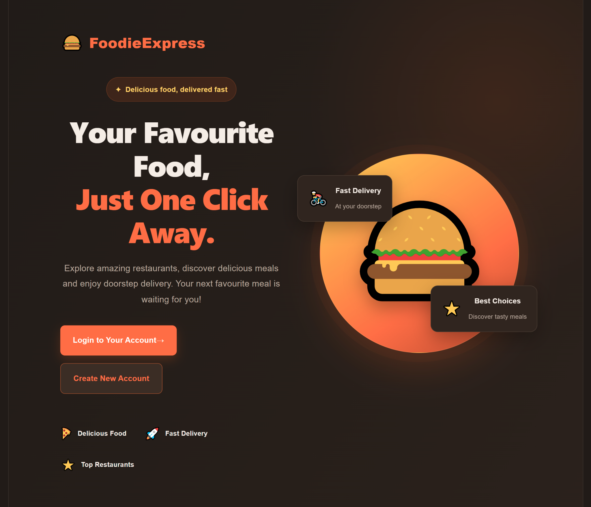
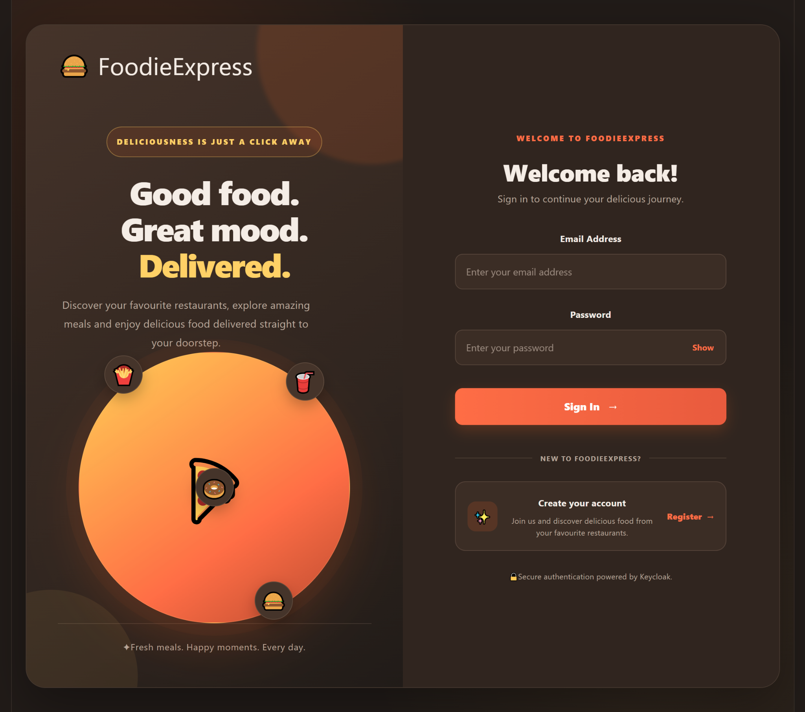
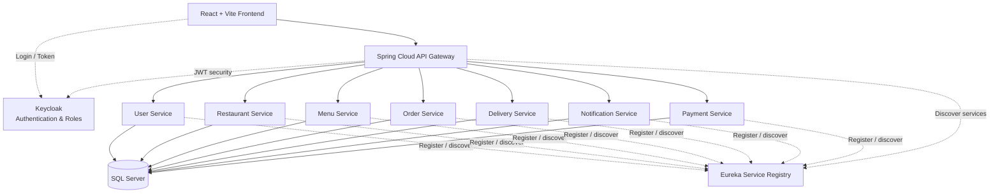

::: {align="center"}
# 🍔 FoodExpress

### A Full-Stack Food Delivery Platform Built with Spring Boot Microservices and React

**Discover restaurants · Order meals · Manage operations · Deliver with
confidence**

[](https://www.java.com/)
[](https://spring.io/projects/spring-boot)
[](https://react.dev/)
[](https://vite.dev/)
[](https://www.microsoft.com/sql-server)
[](https://www.keycloak.org/)
:::

------------------------------------------------------------------------

## 📌 Overview

**FoodExpress** is a full-stack food delivery platform built around a
microservices architecture. It brings customers, restaurant owners,
delivery partners, and administrators together in one application.

Customers can discover restaurants, explore menus, place orders, make
payments, and follow delivery progress. Restaurant owners manage
restaurant information, menu items, and incoming orders. Delivery
partners manage availability and assigned deliveries. Administrators
oversee platform operations, restaurant approvals, partner assignments,
users, payments, and performance.

The project combines a React frontend with independently organized
Spring Boot services, centralized API routing, service discovery, SQL
Server persistence, and Keycloak-based authentication and authorization.

> **Project focus:** modular backend services, secure role-based access,
> end-to-end business workflows, REST API integration, and dedicated
> dashboards for different platform roles.

## ✨ Key Features

-   **Microservices backend** --- separate services for users,
    restaurants, menus, orders, deliveries, notifications, and payments.
-   **Centralized API entry point** --- frontend requests are routed
    through Spring Cloud Gateway.
-   **Service discovery** --- Eureka supports service registration and
    discovery.
-   **Identity and access management** --- Keycloak authentication with
    role-based authorization.
-   **Customer experience** --- restaurant discovery, menu browsing,
    ordering, profile management, and order tracking.
-   **Restaurant workspace** --- restaurant, menu, order, and
    business-performance management.
-   **Delivery workspace** --- availability, assigned deliveries,
    delivery status updates, history, and statistics.
-   **Administration workspace** --- platform overview, restaurant
    management, partner management, role applications, users,
    notifications, and payment oversight.
-   **Payment lifecycle** --- payment creation, completion, status
    synchronization with orders, and refunds.
-   **Responsive interface** --- dedicated layouts and pages for
    different user roles.

## 🖥️ Application Screenshots

### Landing page



### Authentication



### Customer dashboard


### Administrator dashboard


### Restaurant owner dashboard


### Delivery partner dashboard


------------------------------------------------------------------------

## 🧱 Architecture

The React frontend communicates with backend services through the API
Gateway. Eureka provides service discovery, while Keycloak manages
identity and access.



### Component responsibilities

  ---------------------------------------------------------------------
  Component                          Responsibility
  ---------------------------------- ----------------------------------
  React frontend                     User interface, role-specific
                                     dashboards, navigation, and API
                                     integration

  API Gateway                        Centralized routing and entry
                                     point for frontend API requests

  Eureka Server                      Service registration and discovery

  Keycloak                           Authentication, token issuance,
                                     realm roles, and identity
                                     management

  User Service                       User profile and user-related
                                     operations

  Restaurant Service                 Restaurant information and
                                     management

  Menu Service                       Menu items and availability

  Order Service                      Order creation, order lifecycle,
                                     and payment-status integration

  Delivery Service                   Delivery partners, availability,
                                     assignment, and delivery lifecycle

  Notification Service               Notification-related backend
                                     operations

  Payment Service                    Payment records, payment
                                     completion, and refunds

  SQL Server                         Relational persistence for service
                                     data
  ---------------------------------------------------------------------

*This is a logical architecture view. Actual database allocation and
service-to-service communication are determined by each service's
configuration.*

## 🧰 Technology Stack

### Frontend

  Technology                    Purpose
  ----------------------------- ----------------------------------------------------
  React                         Component-based user interface
  Vite                          Frontend development server and build tooling
  React Router                  Client-side routing
  Axios                         HTTP requests and API integration
  Keycloak JavaScript adapter   Frontend authentication integration
  CSS                           Responsive layouts and role-specific visual design

### Backend

  ---------------------------------------------------------------------
  Technology                         Purpose
  ---------------------------------- ----------------------------------
  Java                               Backend programming language

  Spring Boot                        REST API and service
                                     implementation

  Spring Web                         HTTP endpoints and REST
                                     integration

  Spring Security                    Backend security

  Spring Cloud Gateway               API gateway and request routing

  Netflix Eureka                     Service discovery

  Spring Data JPA / Hibernate        Persistence and ORM

  Load-balanced RestTemplate         Service-to-service HTTP
                                     communication where configured
  ---------------------------------------------------------------------

### Data, identity, and developer tools

  Technology             Purpose
  ---------------------- -----------------------------------------
  Microsoft SQL Server   Relational database
  Keycloak               Authentication and role management
  Maven                  Backend dependency and build management
  npm                    Frontend package management
  Eclipse IDE            Backend development environment
  Postman                API testing and verification

## 🧩 Backend Microservices

  Service                  Local port Main responsibility
  ---------------------- ------------ ------------------------------------------
  API Gateway                  `8085` Frontend API entry point and routing
  User Service                 `8081` User profile and user operations
  Restaurant Service           `8082` Restaurant operations
  Menu Service                 `8083` Menu and menu-item operations
  Order Service                `8084` Order creation and order management
  Delivery Service             `8086` Delivery partner and delivery operations
  Notification Service         `8087` Notification operations
  Payment Service              `8088` Payment and refund operations
  Eureka Server                `8761` Service registry
  Keycloak                     `8080` Authentication and identity management

These ports reflect the local development configuration. If a port
changes, update the corresponding service configuration and gateway
route.

## 👥 Role-Based Workspaces

FoodExpress provides distinct experiences based on the authenticated
user's role.

### Customer

-   Browse available restaurants.
-   Explore restaurant menus and food items.
-   Place food orders with delivery details.
-   View personal orders and order status.
-   Follow delivery progress where tracking information is available.
-   Manage profile information.
-   Submit an application to become a restaurant owner or delivery
    partner.

### Restaurant Owner

-   Access the restaurant workspace.
-   Manage registered restaurants.
-   Create and maintain menu items.
-   Manage menu-item availability.
-   View incoming restaurant orders.
-   Process orders through supported status transitions.
-   Review restaurant analytics and operational performance.
-   Update restaurant settings.

### Delivery Partner

-   Access the delivery partner workspace.
-   Manage profile and availability.
-   View assigned deliveries.
-   Accept and process delivery assignments.
-   Update delivery progress through supported statuses.
-   View delivery history and statistics.
-   Share or update location information where enabled.

### Administrator

-   View platform-level dashboard statistics.
-   Review and manage restaurant registrations.
-   Approve or reject restaurant applications.
-   Manage restaurant account status.
-   View and manage delivery partners.
-   Assign ready orders to available delivery partners.
-   Activate or deactivate delivery partners.
-   Review role applications.
-   View users and platform notifications.
-   Monitor payment records and payment details.
-   Review restaurant-wise and platform-level performance.

## 🔐 Authentication and Authorization

FoodExpress uses **Keycloak** for identity and access management.

The local development configuration uses:

-   Realm: `food-delivery`
-   Client: `food-delivery-client`
-   Issuer: `http://localhost:8080/realms/food-delivery`
-   Frontend origin: `http://localhost:5173`
-   Authorization Code Flow with PKCE using `S256`

### Application roles

  ---------------------------------------------------------------------
  Role                               Intended access
  ---------------------------------- ----------------------------------
  `CUSTOMER`                         Customer-facing features

  `ADMIN`                            Administrative operations

  `RESTAURANT_OWNER`                 Restaurant workspace and
                                     restaurant operations

  `DELIVERY_PARTNER`                 Delivery partner workspace and
                                     delivery operations
  ---------------------------------------------------------------------

The frontend integrates with Keycloak and sends bearer access tokens
with protected API requests. Backend security maps Keycloak realm roles
to Spring Security authorities using the `ROLE_` convention.

**Security note:** Configure HTTPS, secure secrets, appropriate token
lifetimes, strict CORS origins, and least-privilege access before
deploying publicly. Never commit client secrets, database passwords,
signing keys, or internal service credentials.

## 🔄 Core Business Workflows

### Order lifecycle

The order service supports the following order states:

``` text
PLACED
  ↓
CONFIRMED
  ↓
PREPARING
  ↓
READY_FOR_PICKUP
  ↓
PICKED_UP
  ↓
OUT_FOR_DELIVERY
  ↓
DELIVERED
```

An order can also be cancelled where the applicable business rules
permit it.

### Delivery workflow

Administrators can assign eligible ready orders to available delivery
partners. Delivery partners process their assignments and update
delivery progress through the supported delivery statuses. Customers can
view delivery information where tracking data is available.

### Payment workflow

The payment service maintains payment records associated with orders.
The implemented workflow includes:

1.  Retrieve order payment details.
2.  Create a payment record for an order.
3.  Validate ownership and payment eligibility.
4.  Complete a pending payment.
5.  Synchronize the payment result with the order service.
6.  Process a refund for an eligible successful payment.

Payment-service statuses:

``` text
PENDING
SUCCESS
FAILED
REFUNDED
CANCELLED
```

The order service maintains its own payment status representation:

``` text
PENDING
PAID
FAILED
REFUNDED
```

The payment and order services communicate through internal APIs for
payment-detail retrieval and payment-status synchronization. Internal
service endpoints must be protected, and shared credentials must be
configured securely.

> **Payment integration note:** Payment lifecycle logic does not, by
> itself, establish integration with a live payment gateway. Configure
> and verify a real payment provider separately before accepting real
> transactions.

## 📁 Repository Structure

The project is organized as a frontend application alongside separate
Spring Boot service projects. The following is a representative layout;
retain the exact module names used in your workspace.

``` text
FoodExpress/
│
├── food-delivery-frontend/
│   ├── public/
│   ├── src/
│   │   ├── components/
│   │   ├── context/
│   │   ├── layouts/
│   │   ├── pages/
│   │   │   ├── admin/
│   │   │   ├── customer/
│   │   │   ├── delivery/
│   │   │   └── restaurant/
│   │   ├── services/
│   │   ├── styles/
│   │   │   ├── admin/
│   │   │   ├── customer/
│   │   │   ├── delivery/
│   │   │   └── restaurant/
│   │   └── ...
│   ├── package.json
│   └── vite.config.js
│
├── api-gateway/
├── user-service/
├── restaurant-service/
├── menu-service/
├── order-service/
├── delivery-service/
├── notification-service/
├── payment-service/
├── eureka-server/
│
├── docs/
│   └── screenshots/
│
└── README.md
```

## ⚙️ Local Development Setup

### Prerequisites

Install the following:

-   Java version compatible with the backend projects (the current
    development environment uses Java 26).
-   Maven.
-   Node.js and npm.
-   Microsoft SQL Server and a database management tool such as SQL
    Server Management Studio.
-   Keycloak.
-   Git.
-   Postman (recommended).
-   Eclipse IDE or another Java IDE (optional).

### 1. Clone the repository

``` bash
git clone https://github.com/arbaj-silar/Food-Delivery-Platform
cd "Food-Delivery-Platform"
```

Replace the placeholders with your repository URL and local directory.

### 2. Configure SQL Server

Create and configure the databases required by the services. The
development setup has used database names including:

-   `Food_Delivery`
-   `FoodDelivery_Orders`
-   `productDB` (used in the payment-service configuration)

The exact database used by each service is defined in that service's
configuration. Check each `application.properties` or `application.yml`
before starting it.

Configure database connection properties, credentials, and
schema-generation/update settings for your local SQL Server instance. Do
not commit real credentials.

### 3. Configure Keycloak

1.  Start Keycloak.
2.  Create or import the `food-delivery` realm.
3.  Configure the `food-delivery-client` client for the frontend.
4.  Configure valid redirect URIs and web origins for the local
    frontend.
5.  Enable the Authorization Code flow with PKCE as required by the
    frontend configuration.
6.  Create the roles `CUSTOMER`, `ADMIN`, `RESTAURANT_OWNER`, and
    `DELIVERY_PARTNER`.
7.  Assign roles to test users.
8.  Verify that the issuer URL matches the frontend and backend
    configuration.

Do not use development redirect URIs or permissive web origins in
production.

### 4. Configure backend services

For each Spring Boot service:

-   Set the correct server port.
-   Configure its SQL Server connection.
-   Configure Eureka registration and discovery.
-   Configure the Keycloak issuer where resource-server security is
    enabled.
-   Configure gateway routes and service URLs.
-   Set internal service credentials through environment variables or a
    secure secrets mechanism.
-   Verify that service-specific configuration is consistent.

### 5. Start the backend

Start infrastructure components first:

1.  Keycloak.
2.  Eureka Server.
3.  Backend microservices.
4.  API Gateway.

Run each Spring Boot project from Eclipse, or from its project directory
using Maven:

``` bash
mvn spring-boot:run
```

If a project includes a Maven wrapper, use the wrapper command provided
in that service's directory.

After startup, verify registered service instances in Eureka:

``` text
http://localhost:8761
```

The API Gateway is expected at:

``` text
http://localhost:8085
```

### 6. Configure and start the frontend

Open a terminal in the frontend directory:

``` bash
cd food-delivery-frontend
npm install
```

Create a local `.env` file using the variable names expected by the
frontend code. The local API base URL points to the gateway:

``` env
VITE_API_BASE_URL=http://localhost:8085
```

Verify the Keycloak variable names and values against the frontend's
existing configuration. Do not assume additional environment-variable
names.

Start the development server:

``` bash
npm run dev
```

Open:

``` text
http://localhost:5173
```

Use a Keycloak test account with the appropriate role to access each
workspace.

### 7. Build the frontend

``` bash
npm run build
```

Vite generates the production build in the frontend build output
directory.

## 🧪 Testing and Verification

Use Postman or another API client to verify backend behavior
independently of the frontend.

Recommended verification sequence:

1.  Confirm that Keycloak issues a valid access token.
2.  Confirm that the gateway is reachable.
3.  Confirm that services register with Eureka.
4.  Verify protected endpoints with a bearer token.
5.  Verify that role-restricted endpoints reject unauthorized roles.
6.  Create a customer profile and verify profile retrieval and update.
7.  Browse restaurants and menu items.
8.  Create an order and verify its status.
9.  Verify that restaurant order operations enforce the intended role.
10. Assign an eligible order to an available delivery partner.
11. Verify delivery status updates and customer tracking data.
12. Create a payment and verify payment-status synchronization with the
    order.
13. Verify that refund rules reject invalid or repeated transitions.

For cross-service failures, inspect the logs of both the calling service
and the receiving service.

## 🔒 Engineering and Security Considerations

-   Keep each service's domain logic inside its own service boundary.
-   Validate ownership before allowing customers to access or modify
    resources.
-   Enforce authorization on the backend; hiding a frontend button is
    not a security control.
-   Validate order and payment state transitions on the server.
-   Protect internal service endpoints with dedicated authentication.
-   Never expose internal service credentials to the browser.
-   Store secrets outside source control.
-   Use explicit CORS origins instead of unrestricted production
    policies.
-   Use HTTPS and secure deployment configuration outside local
    development.
-   Apply consistent error handling and structured logging across
    services.
-   Add automated integration tests for cross-service order, delivery,
    and payment workflows.

## 🛣️ Potential Future Enhancements

These are possible next steps, not claims about currently completed
functionality:

-   Integrate a production payment provider and verified webhook
    handling.
-   Add automated unit, integration, and end-to-end test suites.
-   Add API documentation with OpenAPI/Swagger.
-   Add distributed tracing and centralized log aggregation.
-   Introduce resilient service-to-service communication with timeouts,
    retries, and circuit breakers where appropriate.
-   Add CI/CD pipelines and repeatable deployment environments.
-   Add inventory-aware menu availability and order validation.
-   Improve real-time delivery updates with event-driven messaging.
-   Add customer reviews, ratings, favourites, and order reordering.
-   Add production monitoring, metrics, and alerting.

## 🤝 Contributing

Contributions and suggestions are welcome.

1.  Fork the repository.
2.  Create a feature branch.
3.  Keep changes focused and follow existing service boundaries.
4.  Test the affected frontend or backend workflow.
5.  Submit a pull request with a clear description of the change.

For substantial changes, describe the affected services, API contracts,
database changes, and required configuration updates.

## 📄 License

No license has been specified for this project yet. Add a `LICENSE` file
before presenting the repository as open source or granting reuse
rights.

## 👤 Author

**Arbaj Silar**

Full-Stack Development · Java · Spring Boot · Microservices · React

------------------------------------------------------------------------

::: {align="center"}
**Built with Java, Spring Boot, React, and a focus on practical
full-stack engineering.**

⭐ If you find this project interesting, consider giving the repository
a star.
:::
